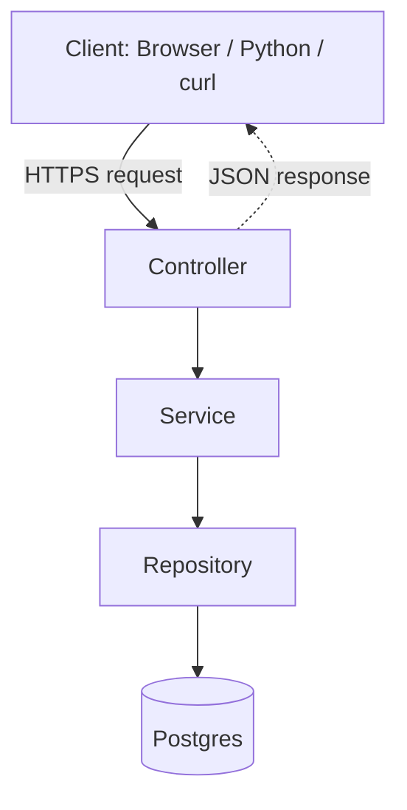

# Our aim

## My role in one sentence
I will be on the team that builds and maintains the backend services
of a lakehouse platform that runs on customers' own servers.

## What is IOMETE?
- A **self-hosted** data lakehouse platform
- Customers (banks, government, big companies) install it on their own servers
- Customers use it to create tables, run SQL queries and Spark jobs
- Their data never leaves their servers → IOMETE can't see it

## I'll be on the platform side
I build the backend system that makes this work.

## The tech stack
| Layer         | Tool             | Job                        |
|---------------|------------------|----------------------------|
| Storage       | MinIO / S3       | Stores the files           |
| Table format  | Apache Iceberg   | Turns files into tables    |
| Compute       | Apache Spark     | Processes big data         |
| Orchestration | Kubernetes       | Runs Spark and services    |
| Backend       | Kotlin + Quarkus | APIs that control it all   |
| Metadata DB   | Postgres         | Job list and their status  |

## What I will do
- Add new API endpoints
- Fix bugs (Controller / Service / Repository)
- Write tests
- Database migrations
- Code that talks to Spark and Kubernetes

## My goal by May 2027
Build `mini-lakehouse`: my own small version of this platform.

---

# What is a lakehouse?

- **OLTP** (Online Transaction Processing) = daily operations (orders, users)
- **OLAP** (Online Analytical Processing) = analysis (reports, trends)
- **ETL** (Extract, Transform, Load) = moving and cleaning data

## Why a lakehouse?
Customers have huge, mixed data and need both SQL analytics and AI,
but their data must stay on their own servers.
- Cheap storage (files in MinIO)
- Real tables + SQL (thanks to Iceberg)
- Open formats → no vendor lock-in
- One copy of data for reports and AI
- Can run self-hosted